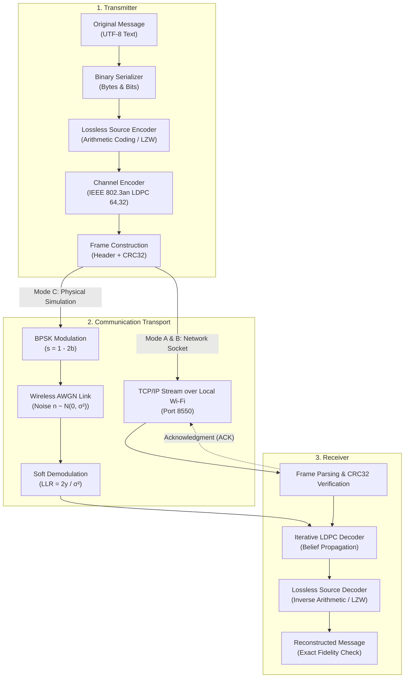

# Wireless Communication System Simulation

**Course Project:** Information Theory and Channel Coding (ITC)  
**System Type:** Wireless Network Digital Communication System  
**Techniques:** Lossless Arithmetic & LZW Source Coding + IEEE 802.3an LDPC Channel Coding + BPSK Modulation + TCP Stream Sockets over Wi-Fi  

---

## 1. Project Overview & Operational Modes

This project implements an end-to-end digital wireless communication system in Python and Streamlit, bridging theoretical information theory with practical network communication. The system features three distinct operational modes:

### Mode A — Live Wireless Message Transmission
Enables interactive point-to-point wireless transmission over a local Wi-Fi or loopback network:
* A user composes a UTF-8 text message on the **Live Message Sender** interface.
* The message undergoes **lossless source coding** (finite-precision Arithmetic Coding or LZW universal dictionary coding).
* The compressed bitstream is protected with systematic **IEEE 802.3an $(64, 32)$ Low-Density Parity-Check (LDPC)** Forward Error Correction (FEC).
* The data is packaged into a **versioned binary wire frame** protected by an IEEE 802.3 **CRC32 checksum**.
* The frame is transmitted across the local Wi-Fi network over a TCP stream socket.
* The **Live Receiver** parses the frame, verifies the checksum, performs LDPC syndrome validation, decompresses the payload, reconstructs the exact message, and returns an explicit acknowledgment (ACK) frame confirming delivery.

### Mode B — Continuous Wireless Source Streamer
Simulates continuous telecommunication telemetry broadcasting:
* Successive information frames are generated at configurable intervals (0.1s to 2.0s) and frame sizes.
* Employs a **bounded FIFO queue** with backpressure monitoring to prevent memory leaks and buffer bloat.
* Tracks live metrics: generated frames, transmitted frames, acknowledged frames, dropped frames, and real-time throughput (bps and fps).
* Supports thread-safe, graceful cancellation.

### Mode C — Wireless Physical Channel Simulation
Simulates the physical layer impairments of an analog wireless channel:
* Baseband **Binary Phase Shift Keying (BPSK)** modulation: $b_i = 0 \to +1.0\text{ V}, b_i = 1 \to -1.0\text{ V}$.
* Wireless **Additive White Gaussian Noise (AWGN)** channel with exact variance scaling:
  $$\sigma = \frac{1}{\sqrt{2 R \cdot 10^{(E_b/N_0)_{\text{dB}} / 10}}}$$
* Soft demodulation computing log-likelihood ratios: $L_i = \frac{2}{\sigma^2} y_i$.
* Iterative log-domain **Sum-Product Belief Propagation** LDPC decoding over the bipartite Tanner graph.
* Direct side-by-side comparison against an uncoded transmission baseline over the exact same channel realization.
* Multi-trial Monte Carlo Bit Error Rate (BER) versus $E_b/N_0$ waterfall curve generation and CSV export.

> [!IMPORTANT]
> **Critical Architectural Distinction:**  
> TCP sockets over local Wi-Fi provide reliable, ordered application-level transport with automatic ARQ. Real-world TCP measurements do not represent raw physical-layer bit error rates. Therefore, physical-layer noise injection and belief-propagation decoding are evaluated strictly in **Mode C (Channel Simulation)**, isolated from TCP transport.

---

## 2. End-to-End Pipeline Architecture



---

## 3. Directory Structure

```
ITC project/
├── README.md                          # Comprehensive system documentation
├── requirements.txt                   # Project dependencies
├── main.py                            # CLI entry point (Demo, Wireless, Experiments)
├── app.py                             # 5-Tab Streamlit interactive dashboard
├── src/                               # Core simulation and communication package
│   ├── source_coding/                 # Source coding algorithms
│   │   ├── arithmetic_codec.py        # Lossless integer Arithmetic / Range Codec
│   │   ├── lzw_codec.py               # Universal adaptive 12-bit LZW Codec
│   │   ├── saturated_source.py        # Continuous telemetry & Markov generator
│   │   └── binary_converter.py        # Bit packing and byte conversions
│   ├── channel_coding/                # Forward Error Correction (FEC)
│   │   ├── ldpc_codec.py              # Systematic (64, 32) LDPC with Sum-Product BP
│   │   ├── polar_codec.py             # Systematic (64, 32) Polar code with SC
│   │   ├── linear_block_codec.py      # Systematic Hamming(7, 4) code
│   │   └── base.py                    # Block segmentation and depadding base class
│   ├── channel_model/                 # Channel models
│   │   ├── wired_channel.py           # Lossless, electrical AWGN, and BSC links
│   │   └── channel_analyzer.py        # Shannon capacity analytics
│   ├── wireless/                      # Wireless communication modules
│   │   ├── frame_protocol.py          # Versioned binary frame format with CRC32
│   │   ├── network_transceiver.py     # WirelessSender and WirelessReceiver TCP sockets
│   │   ├── continuous_streamer.py     # Rate-controlled continuous streaming daemon
│   │   └── channel_sim.py             # BPSK, wireless AWGN, and Monte Carlo runner
│   ├── metrics/                       # Information theory metrics
│   │   └── evaluator.py               # Pre/post-FEC BER, FER, and coding gain
│   └── simulation/                    # Simulation orchestrator
│       ├── pipeline.py                # End-to-end pipeline runner
│       └── experiment_runner.py       # Multi-point Monte Carlo sweeps
├── tests/                             # Automated test suite (69 passing tests)
│   ├── test_arithmetic_coding.py      # Arithmetic codec unit tests
│   ├── test_frame_protocol.py         # Frame serialization and CRC32 tests
│   ├── test_network_transceiver.py    # Socket transceiver integration tests
│   ├── test_continuous_streamer.py    # Continuous streaming lifecycle tests
│   ├── test_wireless_channel_sim.py   # BPSK and wireless simulation tests
│   ├── test_channel_coding.py         # LDPC, Polar, Hamming FEC tests
│   ├── test_channel_model.py          # Channel variance and BER tests
│   ├── test_source_coding.py          # LZW and telemetry generator tests
│   ├── test_pipeline.py               # End-to-end pipeline integration tests
│   └── test_webapp.py                 # Streamlit dashboard and privacy tests
├── results/                           # Measurement outputs and plots
│   ├── csv/                           # Benchmark datasets
│   └── plots/                         # Publication-grade figures
└── paper/                             # IEEE Conference paper deliverable
    └── IEEE_Conference_Paper_23BCE7551.pdf
```

---

## 4. Installation & Environment Setup

### Prerequisites
* **Operating System:** Windows 10 / 11, Linux, or macOS
* **Python Version:** Python 3.10 or Python 3.11 (tested on Python 3.11.9)

### Setup in Windows PowerShell

1. **Clone or navigate to the project directory:**
   ```powershell
   cd "C:\Users\saamsung\OneDrive\Desktop\ITC project"
   ```

2. **Create and activate a Python virtual environment (optional but recommended):**
   ```powershell
   python -m venv .venv
   .\.venv\Scripts\Activate.ps1
   ```

3. **Install required dependencies:**
   ```powershell
   pip install -r requirements.txt
   ```

---

## 5. Running the Application & Demonstrations

### Launching the Streamlit Interactive Dashboard
```powershell
python -m streamlit run app.py
```
Open your browser to `http://127.0.0.1:8501` to access the full 5-tab interface:
* **TAB A:** Live Message Sender
* **TAB B:** Live Receiver
* **TAB C:** Continuous Source Streamer
* **TAB D:** Wireless Channel Simulation
* **TAB E:** Coding Analysis & Mathematical Explanations

---

### CLI Execution Commands

#### 1. Live Wireless Socket Transmission Demo (Mode A)
Launches a loopback TCP receiver, encodes a message with Arithmetic coding + LDPC, transmits the binary frame, verifies CRC32, reconstructs the text, and checks the receiver ACK:
```powershell
python main.py --wireless-demo
```
Custom message and codec:
```powershell
python main.py --wireless-demo --message "Testing Wi-Fi wireless packet!" --codec arithmetic
```

#### 2. Wireless Physical Channel Simulation Demo (Mode C)
Simulates BPSK modulation, AWGN noise, soft demodulation, and iterative LDPC decoding:
```powershell
# At 4.0 dB (waterfall error-suppression region):
python main.py --wireless-sim --snr 4.0

# At 8.0 dB (error-free 100% exact reconstruction):
python main.py --wireless-sim --snr 8.0
```

#### 3. Repeatable Multi-Trial Physical Simulation
Runs 10 independent noise realizations to calculate average pre-FEC BER, post-FEC BER, and Frame Error Rate (FER):
```powershell
python main.py --multi-trial --snr 4.0 --trials 10
python main.py --multi-trial --snr 7.0 --trials 10
```

#### 4. Baseline Wired Transmission Demo
Runs the original baseline demonstration comparing ideal lossless and wired AWGN links:
```powershell
python main.py --demo
```

---

## 6. Two-Computer Wi-Fi Networking Setup

To communicate between two physical computers connected to the same Wi-Fi router:

### Step 1: Find the Receiver's Private IPv4 Address
On the **Receiver Computer**, open PowerShell and run:
```powershell
ipconfig
```
Look for the **IPv4 Address** under `Wireless LAN adapter Wi-Fi` (e.g., `192.168.1.45`).

### Step 2: Configure Windows Firewall
Ensure port `8550` is allowed through Windows Defender Firewall:
1. Open **Windows Defender Firewall with Advanced Security**.
2. Click **Inbound Rules** &rarr; **New Rule**.
3. Select **Port** &rarr; **TCP** &rarr; Specific local ports: `8550`.
4. Select **Allow the connection** &rarr; check **Private** network &rarr; Finish.

### Step 3: Start the Receiver
On the Receiver Computer:
* Launch `python -m streamlit run app.py`.
* Navigate to **TAB B (Live Receiver)**.
* Leave Listen Interface as `0.0.0.0` and Port as `8550`.
* Click **Start Listening**.

### Step 4: Transmit from the Sender Computer
On the Sender Computer:
* Launch `python -m streamlit run app.py`.
* Navigate to **TAB A (Live Message Sender)**.
* In **Receiver Host / IPv4 Address**, enter the receiver's IP (e.g., `192.168.1.45`).
* Enter Port `8550`.
* Type a message and click **Send Wireless Message**.
* The sender displays the confirmation ACK and round-trip time, while the receiver immediately displays the reconstructed message and verified sequence number.

---

## 7. Mathematical & Information Theory Foundations

### 1. Source Coding vs. Channel Coding
* **Source Coding (Data Compression):** Reduces statistical redundancy by mapping source symbols into minimal bit representations, approaching the source entropy $H(X)$. In this project:
  * **Arithmetic Coding:** Encodes strings into a single high-precision interval $[0, 1)$ based on empirical byte frequencies, overcoming the integer-length penalty of Huffman coding.
  * **LZW Codec:** Dynamically builds an adaptive dictionary of recurring character n-grams.
  * **Compression Ratio:**
    $$\text{CR} = \frac{\text{Original Payload Bytes}}{\text{Compressed Payload Bytes}}$$
* **Channel Coding (Error Correction):** Intentionally injects structured algebraic redundancy so that channel-induced bit flips can be detected and corrected at the receiver.
  * **Code Rate:** $R = K / N = 32 / 64 = 0.50$ (100% redundancy overhead).

### 2. IEEE 802.3an LDPC $(64, 32)$ Code
* **Dimensions:** Codeword length $N = 64$, Information length $K = 32$, Parity checks $M = 32$.
* **Orthogonality:** Parity-check matrix $H \in \mathbb{F}_2^{32 \times 64}$ and generator matrix $G \in \mathbb{F}_2^{32 \times 64}$ satisfy:
  $$G \cdot H^T \equiv \mathbf{0} \pmod 2$$
* **Log-Domain Belief Propagation (Sum-Product Algorithm):**
  * Variable-to-Check Message:
    $$q_{mn} = L_n + \sum_{c \in C(n) \setminus m} r_{cn}$$
  * Check-to-Variable Message:
    $$\tanh\left(\frac{r_{mn}}{2}\right) = \prod_{j \in V(m) \setminus n} \tanh\left(\frac{q_{mj}}{2}\right)$$
  * Posterior LLR Decision: $\hat{c}_n = 1$ if $Q_n < 0$, else $\hat{c}_n = 0$.

### 3. Bit Error Rate (BER) Calculation
* **Pre-FEC BER:** Evaluates hard-sliced channel decisions against transmitted codeword bits:
  $$\text{BER}_{\text{pre}} = \frac{\sum_{i=1}^N c_i \oplus \hat{r}_i}{N}$$
* **Post-FEC BER:** Evaluates decoded information bits against original source bits:
  $$\text{BER}_{\text{post}} = \frac{\sum_{i=1}^K m_i \oplus \hat{m}_i}{K}$$
* **Error Suppression Gain:**
  $$\text{Gain} = \frac{\text{BER}_{\text{pre}}}{\max(\text{BER}_{\text{post}}, 10^{-12})}$$

---

## 8. Automated Testing

All 69 automated tests can be executed with:
```powershell
python -m pytest tests/ -v
```

### Test Suite Structure
| Test Module | Tests | Description |
| :--- | :---: | :--- |
| `test_arithmetic_coding.py` | 7 | Exact roundtrip, Unicode, binary bytes, empty inputs, compression ratio |
| `test_frame_protocol.py` | 5 | Serialization, ACK frames, CRC32 corruption detection, socket framing |
| `test_network_transceiver.py` | 4 | Required integration test (`"Hello, this is my wireless ITC project!"`), LZW, sequence preservation, error handling |
| `test_continuous_streamer.py` | 2 | Continuous stream start/stop lifecycle, throughput metrics, backpressure |
| `test_wireless_channel_sim.py` | 5 | BPSK modulation, theoretical AWGN formula, LDPC decoding, SNR sweep |
| `test_channel_coding.py` | 15 | LDPC orthogonality, belief propagation, min-sum, polar SC, Hamming |
| `test_channel_model.py` | 7 | Lossless channel, BSC bit-flip rates, AWGN variance, capacity |
| `test_source_coding.py` | 12 | Saturated telemetry source, Markov bitstream, LZW dictionary growth |
| `test_pipeline.py` | 9 | End-to-end pipeline integration, lossless, AWGN, metrics |
| `test_webapp.py` | 3 | Streamlit HTTP server online, syntax check, header privacy |
| **Total Passing Tests** | **69** | **100% Pass Rate** |

---

## 9. Physical & Operational Limitations

1. **Local Wi-Fi Network Visibility:** Communication between two physical computers requires both devices to be connected to the same Wi-Fi subnet (AP isolation must be disabled) and Windows Firewall must allow inbound traffic on port `8550`.
2. **TCP ARQ vs. Raw Physical Bit Errors:** Mode A and Mode B operate over TCP sockets, which guarantee reliable delivery through retransmissions. To observe analog bit error rates and waterfall behavior, use Mode C (Physical Channel Simulation).
3. **Finite Blocklength Waterfall Region:** The $(64, 32)$ LDPC code has blocklength $N=64$. At $E_b/N_0 = 4.0\text{ dB}$, the code operates in its finite-length waterfall region ($\text{BER} \approx 10^{-3}$, $\approx 35\times$ error reduction). At $E_b/N_0 \ge 7.0\text{ dB}$, error-free decoding ($\text{BER} = 0.0000$) is achieved.
4. **Adaptive Dictionary Desynchronization in Corrupted Channels:** When source coding is applied, any uncorrected bit errors from the channel will cause dictionary misalignment during decompression. Strong FEC is essential before decompressing source-coded streams.
