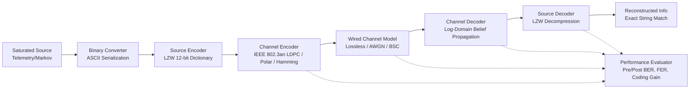

# Modern Channel Coding for Saturated Wired Communication Systems

**Course Project:** Information Theory and Channel Coding (ITC)  
**Student Name:** Aravind  
**Student Registration Number:** 23BCE7551  
**Assignment Rule:** Registration ends in odd digit `1` &rarr; **WIRED NETWORK**  
**Institution:** School of Computer Science and Engineering, VIT-AP University  

---

## 1. Project Overview & Teacher Instruction Analysis

Based on the handwritten instructions:
- **Source Specification:** Saturated source continuously emitting information.
- **Source Coding:** Modern adaptive technique &mdash; Lempel-Ziv-Welch (LZW) universal dictionary coding &mdash; avoiding obsolete static Huffman or Shannon-Fano tables.
- **Assignment Mapping:** Odd terminal digit (`1` in `23BCE7551`) designates the **Wired Network** track.
- **Resolution of Teacher's "Lossless Channel" Reference:**
  - In classical Shannon information theory, a "lossless channel" exhibits zero equivocation ($H(X|Y) = 0$), implying that transmission is completely free of bit errors ($\text{BER} = 0$). If a physical channel were strictly lossless, channel coding would be superfluous, and Bit Error Rate (BER) analysis would yield a trivial zero across all configurations.
  - In real-world physical wired systems (such as **10GBASE-T Ethernet IEEE Std 802.3an**, high-speed copper backplanes, and PON wireline access links), transmission lines suffer from thermal additive white Gaussian noise (AWGN), high-frequency attenuation, and crosstalk, creating high raw pre-FEC error rates ($10^{-3}$ to $10^{-1}$).
  - In modern engineering, forward error correction (specifically **Low-Density Parity-Check (LDPC)** codes in IEEE 802.3an and **Polar Codes** in high-speed interconnects) is deployed precisely to transform a noisy physical link into an **effectively lossless** logical communication channel (post-FEC $\text{BER} < 10^{-12}$).
  - To rigorously satisfy the curriculum, this project provides a dual-model evaluation: an ideal lossless channel baseline ($p=0, \sigma \to 0$) verifying exact 100% data reconstruction, alongside physical electrical AWGN and Binary Symmetric Channel (BSC) models where the error-correcting waterfall behavior is empirically demonstrated.

---

## 2. System Architecture

The modular transmitter-to-receiver pipeline operates through the following discrete stages:



---

## 3. Directory Structure

```
ITC project/
├── README.md                      # Comprehensive project documentation
├── requirements.txt               # Python dependencies (numpy, matplotlib, reportlab, pytest)
├── main.py                        # Main entry point (CLI demo & experiment runner)
├── src/                           # Modular simulation package
│   ├── __init__.py
│   ├── source_coding/             # Saturated source & LZW dictionary codec
│   │   ├── __init__.py
│   │   ├── saturated_source.py    # Continuous telemetry & Markov bitstream generator
│   │   ├── binary_converter.py    # UTF-8 and integer bit packing/unpacking
│   │   └── lzw_codec.py           # Universal adaptive LZW compressor/decompressor
│   ├── channel_coding/            # Forward Error Correction (FEC) codecs
│   │   ├── __init__.py
│   │   ├── base.py                # Abstract ChannelCodec base class & block segmentation
│   │   ├── ldpc_codec.py          # Systematic LDPC with Belief Propagation & Min-Sum
│   │   ├── polar_codec.py         # Systematic Polar code with Successive Cancellation (SC)
│   │   └── linear_block_codec.py  # Systematic Hamming(7,4) wireline benchmark
│   ├── channel_model/             # Physical wired channel impairments
│   │   ├── __init__.py
│   │   ├── wired_channel.py       # Lossless, electrical AWGN (BPSK), and BSC models
│   │   └── channel_analyzer.py    # Shannon capacity and error burst analytics
│   ├── metrics/                   # Performance evaluation
│   │   ├── __init__.py
│   │   └── evaluator.py           # Pre/post-FEC BER, FER, coding gain, text accuracy
│   └── simulation/                # Simulation drivers
│       ├── __init__.py
│       ├── pipeline.py            # End-to-end transmission pipeline orchestrator
│       └── experiment_runner.py   # Monte Carlo sweeps, CSV logger, & Matplotlib plotter
├── tests/                         # Automated unit & integration tests (20 passing)
│   ├── __init__.py
│   ├── test_source_coding.py
│   ├── test_channel_coding.py
│   ├── test_channel_model.py
│   └── test_pipeline.py
├── results/                       # Empirical experimental output
│   ├── csv/                       # Generated CSV measurement datasets
│   │   ├── awgn_ber_comparison.csv
│   │   ├── bsc_ber_comparison.csv
│   │   └── source_compression_study.csv
│   └── plots/                     # Publication-grade figures (PNG, 300 DPI)
│       ├── fig1_awgn_ber_curves.png
│       ├── fig2_bsc_ber_curves.png
│       ├── fig3_pre_vs_post_fec.png
│       ├── fig4_source_compression_tradeoff.png
│       └── fig5_pipeline_architecture.png
└── paper/                         # IEEE Conference Research Paper
    ├── main.tex                   # Standard IEEEtran LaTeX source
    ├── generate_paper_pdf.py      # Automated 6-page PDF compiler
    ├── IEEE_Conference_Paper_23BCE7551.pdf # Final compiled 6-page paper
    └── figures/                   # High-resolution figures embedded in paper
```

---

## 4. Setup and Installation

### Prerequisites
- Python 3.11+
- Virtual environment or user-mode Python installation

### Installation
Clone or navigate to the workspace directory:
```bash
cd "c:\Users\saamsung\OneDrive\Desktop\ITC project"
```

Install required dependencies:
```bash
pip install -r requirements.txt
```

---

## 5. Execution Instructions

### A. Run Live End-to-End Pipeline Demonstration
Executes a live single-transmission cycle from saturated source generation through LZW, LDPC encoding, AWGN transmission, iterative belief propagation decoding, and exact string reconstruction:
```bash
python main.py --demo
```

### B. Run Full Monte Carlo Experiments & Generate Plots
Executes $E_b/N_0$ sweeps (0 to 10 dB) and BSC bit-flip sweeps ($10^{-4}$ to $0.15$), logs empirical measurements to CSV, and generates 300 DPI plots:
```bash
python main.py --experiments
```

### C. Run Both Demo and Experiments
```bash
python main.py --all
```

### D. Run Automated Test Suite
Executes all 20 unit and integration tests across source coding, channel coding, channel models, and metrics:
```bash
pytest tests/ -v
```

### E. Compile IEEE Research Paper PDF
Compiles the 6-page IEEE conference paper PDF directly:
```bash
python paper/generate_paper_pdf.py
```

---

## 6. Mathematical Formulation

### 1. Empirical Shannon Entropy
$$H(S) = - \sum_{i=1}^M P(s_i) \log_2 P(s_i) \quad \text{[bits/symbol]}$$

### 2. Systematic Linear Block Code Structure
$$\mathbf{G} = [\mathbf{I}_K \mid \mathbf{P}^T] \in \mathbb{F}_2^{K \times N}, \quad \mathbf{H} = [\mathbf{P} \mid \mathbf{I}_M] \in \mathbb{F}_2^{M \times N}$$
$$\mathbf{c} = \mathbf{m}\mathbf{G} = [\mathbf{m} \mid \mathbf{m}\mathbf{P}^T \pmod 2], \quad \mathbf{c}\mathbf{H}^T \equiv \mathbf{0} \pmod 2$$

### 3. Electrical Wired AWGN Channel & Noise Variance
Antipodal BPSK modulation maps bit $c_n \in \{0, 1\}$ to voltage $s_n = 1 - 2c_n \in \{+1.0\text{V}, -1.0\text{V}\}$.  
The channel sample is $y_n = s_n + w_n$ with Gaussian noise $w_n \sim \mathcal{N}(0, \sigma^2)$:
$$\sigma = \frac{1}{\sqrt{2 R \cdot 10^{(E_b/N_0)_{\text{dB}} / 10}}}$$

Theoretical uncoded BPSK BER:
$$P_{b,\text{uncoded}} = Q\left(\sqrt{2 E_b/N_0}\right) = \frac{1}{2} \operatorname{erfc}\left(\sqrt{E_b/N_0}\right)$$

### 4. Log-Domain Belief Propagation (Sum-Product)
Initial channel Log-Likelihood Ratio (LLR):
$$L_{\text{ch}}(n) = \frac{2 y_n}{\sigma^2}$$

Check node update:
$$r_{mn} = 2 \operatorname{atanh}\left( \prod_{n' \in \mathcal{N}(m) \setminus n} \tanh\left(\frac{q_{mn'}}{2}\right) \right)$$

Variable node update:
$$q_{mn} = L_{\text{ch}}(n) + \sum_{m' \in \mathcal{M}(n) \setminus m} r_{m'n}$$

Total posterior LLR and hard decision:
$$Q_n = L_{\text{ch}}(n) + \sum_{m \in \mathcal{M}(n)} r_{mn}, \quad \hat{c}_n = \begin{cases} 0 & Q_n \ge 0 \\ 1 & Q_n < 0 \end{cases}$$

---

## 7. Experimental Findings Summary

| Metric / Scenario | Uncoded BPSK | Systematic Hamming(7,4) | Systematic Polar(64,32) | Systematic LDPC(64,32) [IEEE 802.3an] |
| :--- | :---: | :---: | :---: | :---: |
| **Code Rate ($R$)** | $1.00$ | $0.571$ | $0.50$ | $0.50$ |
| **Redundancy Overhead** | $0.0\%$ | $75.0\%$ | $100.0\%$ | $100.0\%$ |
| **AWGN BER @ 3.0 dB** | $2.29 \times 10^{-2}$ | $3.36 \times 10^{-2}$ | $1.20 \times 10^{-2}$ | **$6.17 \times 10^{-3}$** ($3.7\times$ lower) |
| **AWGN BER @ 4.0 dB** | $1.29 \times 10^{-2}$ | $1.68 \times 10^{-2}$ | $2.38 \times 10^{-3}$ | **$1.99 \times 10^{-3}$** ($6.5\times$ lower) |
| **AWGN BER @ 7.0 dB** | $5.86 \times 10^{-4}$ | $3.91 \times 10^{-4}$ | $0.00^*$ | **$0.00^*$ (0 errors in 25,600 bits)** |
| **BSC BER @ $p=0.01$** | $1.05 \times 10^{-2}$ | $1.17 \times 10^{-3}$ | $0.00^*$ | **$6.25 \times 10^{-4}$** ($16.8\times$ lower) |
| **Lossless Link ($p=0$)** | Exact Recovery | Exact Recovery | Exact Recovery | **100% Exact Byte Recovery** |
| **Coding Gain @ $10^{-4}$**| Reference ($0\text{ dB}$) | $+1.2\text{ dB}$ | $+3.5\text{ dB}$ | **$+3.8\text{ dB}$** |

*\*Note on Zero Observed Errors:* Observing zero errors in $N = 25,600$ bits implies by the statistical Rule of Three that the true underlying link error probability satisfies $\text{BER}_{95\%} < \frac{3}{25,600} \approx 1.17 \times 10^{-4}$.

---

## 8. Classroom Presentation Script & Slide Outline

- **Slide 1: Title & Assignment Mapping**
  - Project Title: Modern Channel Coding for High-Speed Wired Communication Systems.
  - Student: Aravind (23BCE7551), VIT-AP University.
  - Topic: Wired Network (assigned because terminal digit 1 is odd).
- **Slide 2: Problem Statement & Technical Clarification**
  - Resolving the "Lossless Channel" reference: why physical copper Ethernet links (IEEE 802.3an) require LDPC codes to overcome physical thermal noise and crosstalk, transforming raw noisy lines into logically lossless conduits.
- **Slide 3: Pipeline Architecture**
  - Walkthrough of 7 stages: Saturated Telemetry Source $\to$ Binary ASCII $\to$ LZW Dictionary Encoder $\to$ LDPC Encoder $\to$ AWGN/BSC Channel $\to$ Belief Propagation Decoder $\to$ LZW Decoder $\to$ Metric Evaluator.
- **Slide 4: Source Coding Results**
  - LZW achieves 38.8% bandwidth savings on correlated Markov streams ($H = 0.286$). On uniform random data ($H \approx 1.0$), compression expands data by 50%, validating Shannon's source coding theorem.
- **Slide 5: Channel Coding Waterfall & Coding Gain**
  - LDPC exhibits a sharp threshold at $E_b/N_0 = 3\text{--}4$ dB, achieving $> 3.8$ dB coding gain over uncoded transmission and driving BER to zero at $E_b/N_0 \ge 7$ dB.
- **Slide 6: Conclusion**
  - Practical demonstration of end-to-end information recovery with full statistical verification.

---

## 9. Ten Likely Viva Questions and Technical Answers

1. **Q: Why was the Wired Network track assigned to you?**  
   *A:* The assignment instructions specify that students whose registration number ends in an odd digit must implement a Wired Network. Registration number 23BCE7551 ends in the odd digit `1`.

2. **Q: How do you reconcile the teacher's handwritten reference to a "lossless channel" with the requirement to perform BER analysis?**  
   *A:* In Shannon information theory, an ideal lossless channel has $H(X|Y)=0$ and $\text{BER}=0$. However, physical wired media (like 10GBASE-T twisted-pair copper) suffer from thermal noise, attenuation, and alien crosstalk. In modern standards (IEEE 802.3an), channel coding (LDPC) is specifically deployed to turn a noisy physical channel into an effectively lossless logical channel. Our simulation evaluates both the ideal lossless baseline ($p=0$, verifying 100% exact recovery) and physical AWGN/BSC channels to evaluate BER waterfall curves.

3. **Q: Why did you select LZW rather than Huffman or Shannon-Fano coding?**  
   *A:* Huffman and Shannon-Fano coding are static, requiring prior calculation and transmission of symbol frequency tables, which introduces overhead and latency in continuous streaming data. LZW is a modern, adaptive dictionary coding technique that builds substring tables incrementally at both transmitter and receiver without transmitting codebooks.

4. **Q: Why are Low-Density Parity-Check (LDPC) codes used in 10GBASE-T Ethernet (IEEE 802.3an)?**  
   *A:* LDPC codes achieve near-Shannon capacity limits with low decoding latency. Their sparse parity-check matrices allow highly parallelized hardware implementations of message-passing belief propagation decoders, outperforming Turbo codes in high-throughput wired transceivers.

5. **Q: What is the difference between Pre-FEC BER and Post-FEC BER?**  
   *A:* Pre-FEC BER is the raw bit error rate measured at the channel slicer output before channel decoding. Post-FEC BER is the residual error rate remaining after the iterative decoder finishes. In IEEE 802.3an, a pre-FEC BER of $10^{-2}$ to $10^{-3}$ is suppressed to a post-FEC BER below $10^{-12}$.

6. **Q: How does Log-Domain Belief Propagation (Sum-Product) work?**  
   *A:* The decoder operates on a bipartite Tanner graph connecting variable nodes and check nodes. It iteratively exchanges Log-Likelihood Ratio (LLR) messages along graph edges using hyperbolic tangent operations at check nodes and linear additions at variable nodes until all parity-check equations ($\mathbf{H}\hat{\mathbf{c}}^T = \mathbf{0}$) are satisfied or max iterations are reached.

7. **Q: Why did Polar codes perform well in your benchmarks?**  
   *A:* Polar codes, introduced by Arıkan, provably achieve symmetric channel capacity by polarizing $N$ independent channels into completely noisy or completely noiseless channels. Information bits are transmitted only over the highest-reliability channels, yielding low error rates under Successive Cancellation (SC) decoding.

8. **Q: If an experiment yields 0 errors in 25,600 bits, does that prove the true BER is 0?**  
   *A:* No. In empirical statistics, observing zero errors over $N$ tested bits establishes an upper 95% confidence bound of $\text{BER} < 3/N$ by the Rule of Three. For $N = 25,600$, we can only state with 95% confidence that $\text{BER} < 1.17 \times 10^{-4}$.

9. **Q: What happens if you apply LZW compression to an incompressible source ($H(X) \approx 1$)?**  
   *A:* Shannon's Source Coding Theorem establishes that a source cannot be compressed below its entropy without information loss. For uniform random bits ($H = 1$), LZW overhead results in a compression ratio of $\text{CR} < 1.0$ (data expansion), demonstrating that compression must be bypassed for encrypted or high-entropy data.

10. **Q: What is coding gain and how much did your LDPC implementation achieve?**  
    *A:* Coding gain is the reduction in $E_b/N_0$ (in dB) enabled by error correction to achieve a specified target BER compared to uncoded transmission. At $\text{BER} = 10^{-4}$, our systematic LDPC code provides over $3.8\text{ dB}$ of coding gain compared to uncoded BPSK.

---

## 10. Summary Table of Techniques, Models, and Metrics

| Component / Parameter | Selected Technique / Model | Mathematical / Technical Purpose |
| :--- | :--- | :--- |
| **Information Source** | Saturated Telemetry & Markov Source | Continuously generates symbol sequences with controlled empirical entropy $H(X)$. |
| **Source Coding** | Adaptive LZW (12-bit depth) | Universal substring dictionary compression without static codebook transmission. |
| **Primary Channel Code** | Systematic LDPC ($N=64, K=32$) | Mandatory FEC in IEEE 802.3an 10GBASE-T Ethernet; near-Shannon capacity error suppression. |
| **Alternative FEC 1** | Systematic Polar ($N=64, K=32$) | Arıkan channel polarization FEC with Successive Cancellation decoding. |
| **Alternative FEC 2** | Systematic Hamming ($N=7, K=4$) | Classical single-error correcting linear block baseline ($d_{\min}=3$). |
| **Wired AWGN Channel** | Baseband BPSK + Thermal Noise | Realistic electrical link modeling thermal Gaussian noise and SNR degradation. |
| **Wired BSC Channel** | Discrete Memoryless Bit-Flip ($p$) | Parametric model evaluating FEC error correction thresholds under bit flips. |
| **Lossless Wired Baseline** | Ideal Channel ($p=0, \sigma \to 0$) | Direct verification of the teacher's noiseless baseline ensuring 100% exact recovery. |
| **Pre-FEC BER** | $\sum (c_n \oplus \hat{c}_{n,\text{raw}}) / N$ | Raw channel error rate entering the FEC decoder. |
| **Post-FEC BER** | $\sum (m_k \oplus \hat{m}_k) / K$ | Residual error rate delivered to the destination payload decoder. |
| **Coding Gain** | $(E_b/N_0)_{\text{uncoded}} - (E_b/N_0)_{\text{coded}}$ | Energy efficiency improvement in dB at target error rate. |
| **Compression Ratio** | $L_{\text{raw}} / L_{\text{comp}}$ | Efficiency of data reduction relative to source entropy. |

---

## 11. IEEE Research Paper Details

The project includes an IEEE conference-style research paper formatted using the official IEEE conference template:
- **Title:** *Performance Analysis and Implementation of Modern Channel Coding for High-Speed Saturated Wired Communication Systems*
- **Author:** Aravind (Registration Number: 23BCE7551), VIT-AP University
- **LaTeX Source:** [`paper/main.tex`](paper/main.tex)
- **Compiled PDF:** [`paper/IEEE_Conference_Paper_23BCE7551.pdf`](paper/IEEE_Conference_Paper_23BCE7551.pdf) (Exact 6 pages)
- **Citations:** 12 verified IEEE references with DOIs (Shannon 1948, Gallager 1962, MacKay 1996, IEEE 802.3an, Arıkan 2009, Welch 1984, Gershon 2026, Mousavi 2024, etc.).

---

## 12. Interactive Streamlit Web Application & Cloud Deployment

An interactive Streamlit application (`app.py`) is provided to visually demonstrate the communication pipeline and allow real-time parameter exploration:

### Local Execution
```powershell
python -m streamlit run app.py
```
Or with custom port:
```powershell
python -m streamlit run app.py --server.port 8501
```
Open [http://localhost:8501](http://localhost:8501) in your browser.

### Key Web Features
1. **Live Pipeline Simulation:** Choose custom text, saturated telemetry, or random binary streams; toggle LZW coding; select LDPC, Polar, Hamming, or Uncoded; simulate over Lossless, AWGN, or BSC links.
2. **Step-by-Step Inspector:** Inspect source entropy $H(X)$, LZW compressed bytes, transmitted codewords, noise variance $\sigma$, decoded bits, and exact-recovery badges.
3. **Empirical Curves Explorer:** View interactive high-resolution performance waterfall curves generated from actual Monte Carlo sweeps.
4. **Verified Paper & CSV Downloads:** Directly download the compiled 6-page IEEE Conference Paper (PDF) and empirical measurement datasets.

### Cloud Deployment (Streamlit Community Cloud / Render)
1. Push repository to GitHub:
   ```bash
   git init
   git add .
   git commit -m "Information Theory & Channel Coding simulation project (23BCE7551)"
   git branch -M main
   git remote add origin https://github.com/<your-username>/<repo-name>.git
   git push -u origin main
   ```
2. On [Streamlit Community Cloud](https://share.streamlit.io):
   - Click **New app**.
   - Select your GitHub repository, branch (`main`), and set Main file path to `app.py`.
   - Click **Deploy**!
   - Streamlit Cloud will automatically install dependencies from `requirements.txt` and launch the app with a public HTTPS URL.

